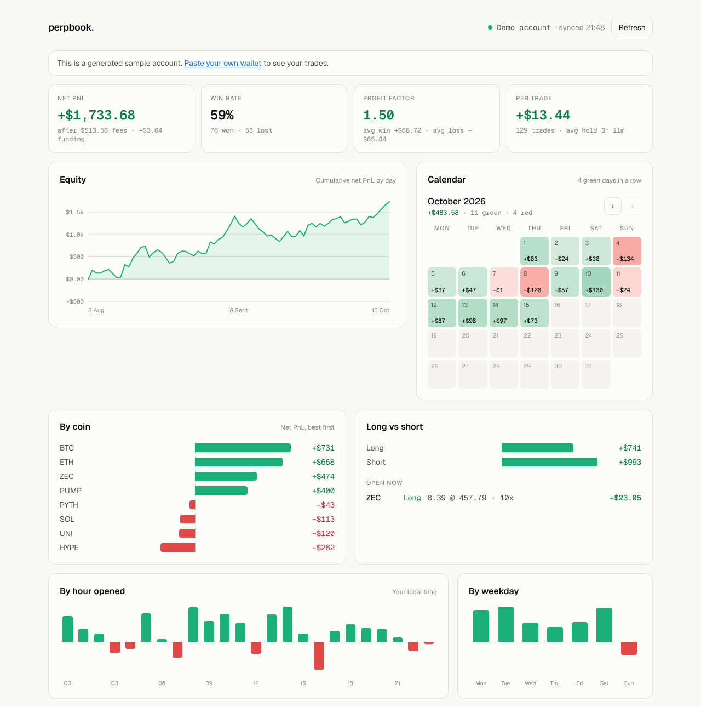

# perpbook

**The open-source trading journal for perp traders.** Paste a Hyperliquid wallet address and get every trade rebuilt, your real PnL after fees and funding, and where your edge actually is. No API keys, no CSVs, no manual entry.

- **Trades, not fills.** Scale in three times and out twice and it's still one trade. Flips are split into a closed trade and a new one; fees and funding go to the right trade.
- **Real PnL.** Net of fees and hourly funding, by day, by coin, long vs short, by hour and by weekday.
- **Read-only.** perpbook only reads public data for an address. It never asks for keys or signatures.
- **Yours.** AGPL-3.0. Self-host it for free, or use the hosted version.

<picture>
  <source media="(prefers-color-scheme: dark)" srcset="docs/dashboard-dark.png">
  
</picture>

Works for Hyperliquid perps, including front-ends built on it (such as Invo) and builder-deployed (HIP-3) markets.

## Try it

```bash
npm install
npm run dev
```

Open <http://localhost:3000> and paste an address, or go to `/w/demo` for a generated sample account.

## How it works

```
src/lib/hyperliquid/   client for the public info endpoint + normalisation (spot filtered out, de-duplicated)
src/lib/engine/        trades.ts  rebuilds round trips from fills
                       stats.ts   win rate, profit factor, expectancy, breakdowns, daily PnL, equity
src/components/        dashboard, equity chart, PnL calendar, breakdown bars, trades table
```

**Trade reconstruction.** A trade opens when a coin's position leaves zero and closes when it returns to zero. Hyperliquid reports the position size before every fill (`startPosition`), which perpbook treats as the source of truth. That also catches gaps: if the reported size disagrees with what we've tracked, the trade is closed and flagged `partial` rather than silently producing wrong numbers.

**The 10,000-fill limit.** Hyperliquid's API only exposes your most recent 10,000 fills. Today perpbook reads them straight from the browser, so very active traders will see older history drop off. Stored, permanent history is the next milestone (see the roadmap).

## Tests

```bash
npm test
```

The engine is covered for simple round trips, scaling in and out, flips, positions opened before the available history, missing fills, multi-coin accounts, funding attribution, spot filtering and the stats maths.

## Roadmap

- [x] Wallet sync, trade reconstruction, dashboard, PnL calendar, breakdowns
- [ ] Accounts, Postgres storage and a sync worker (permanent history past 10,000 fills)
- [ ] Notes, setup tags and mistake tags on every trade; R multiples from a planned stop
- [ ] CSV import with a TradeZella preset
- [ ] One-command self-hosting with Docker Compose
- [ ] Hosted Pro plan: unlimited wallets, full history, breakdowns by setup, AI weekly review

## Contributing

Issues and pull requests are welcome; see [CONTRIBUTING.md](CONTRIBUTING.md). New venue adapters are the most useful contribution.

## Licence

[AGPL-3.0](LICENSE). You can use, modify and self-host perpbook freely. If you offer a modified version to others as a service, you must publish your changes under the same licence.

perpbook is an analytics tool, not financial advice.
